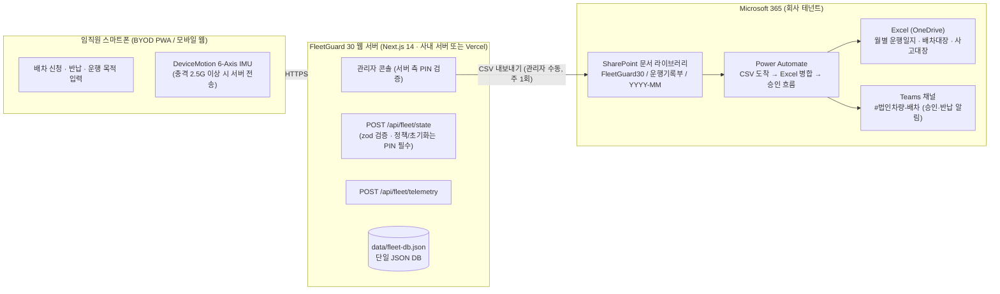

# FleetGuard 30 (Opelika, AL) — 웹배포 및 Microsoft 365 운영 관리 계획

> **대상 사업장:** `4400 Northpark Dr, Opelika, AL 36801` (Lee County, Alabama · `AL 41` 법인차량 30대)
> **핵심 전제:** 차량 내장 블랙박스(Dashcam) 0대 · 상업용 OBD/GPS 단말기 0대 · 월간 통신 구독료 **\$0**
> **저장소 전제:** 외부 DB(Supabase 등) 미연동. 앱은 서버 로컬 **JSON 데이터베이스**(`data/fleet-db.json`)에 저장하고, **기록 보관·공유·결재는 회사가 이미 쓰는 Microsoft 365(SharePoint · OneDrive · Excel · Teams)**로 처리한다.

---

## 1. 운영 아키텍처 개요 (Web App + Microsoft 365)



**역할 분담 (한 줄 요약):** 웹앱은 "오늘 누가 어떤 차를 타고 있는가"를 실시간으로 다루는 **운영 장부**, Microsoft 365는 "지난달 운행기록이 어디 있는가"를 답하는 **보관 장부**다.

---

## 2. 구현 완료된 구성요소

| 구분 | 구현 파일 | 역할 및 설명 |
|---|---|---|
| **배포 설정** | [`vercel.json`](file:///c:/dev/GPS/vercel.json) | `iad1` 리전, 보안 헤더, 스마트폰 센서 `Permissions-Policy` |
| **모바일 PWA 매니페스트** | [`manifest.json`](file:///c:/dev/GPS/public/manifest.json) | 앱스토어 없이 홈 화면 설치 |
| **스마트폰 센서 브릿지** | [`realDeviceSensors.ts`](file:///c:/dev/GPS/src/utils/realDeviceSensors.ts) | GPS · 6축 IMU · Web Bluetooth · Opelika HQ Haversine 거리 |
| **상태 저장 API** | [`route.ts` (state)](file:///c:/dev/GPS/src/app/api/fleet/state/route.ts) | zod 스키마 검증, `RESET_SEED`·정책 변경은 `x-admin-pin` 헤더 필수 |
| **텔레메트리 API** | [`route.ts` (telemetry)](file:///c:/dev/GPS/src/app/api/fleet/telemetry/route.ts) | zod 검증, 충돌 vs 휴대폰 낙하 Sensor Fusion, 무단 운행 판정 |
| **관리자 PIN 검증 API** | [`route.ts` (verify-pin)](file:///c:/dev/GPS/src/app/api/admin/verify-pin/route.ts) | PIN은 서버 환경변수 `FLEET_ADMIN_PIN`에만 존재 (브라우저 번들에 미포함) |
| **입력 검증 스키마** | [`fleetSchemas.ts`](file:///c:/dev/GPS/src/lib/fleetSchemas.ts) | 차량·임직원·배차·사고·운행일지·정책 전 엔티티 zod 스키마 |
| **JSON 데이터베이스** | [`fleetDatabase.ts`](file:///c:/dev/GPS/src/lib/fleetDatabase.ts) | `data/fleet-db.json` 읽기/병합/쓰기 (git 추적 제외) |
| **헬스체크 API** | [`route.ts` (health)](file:///c:/dev/GPS/src/app/api/health/route.ts) | 배포 후 상태 점검 |
| **환경변수 템플릿** | [`.env.example`](file:///c:/dev/GPS/.env.example) | HQ 좌표, `FLEET_ADMIN_PIN` |

> `supabase/migrations/001_fleetguard30_schema.sql`은 **향후 외부 DB 전환 시 참고용**으로만 보관하며 현재 운영에는 사용하지 않는다.

---

## 3. 단계별 배포 절차

### Phase 1 — 웹 서버 배포 (소요 시간: 10분)

JSON DB는 **서버 디스크에 파일로 남아야** 한다. 따라서 배포 대상은 다음 중 하나를 택한다.

| 선택지 | 적합한 경우 | 데이터 보존 |
|---|---|---|
| **A. 사내 Windows/Linux 서버 (권장)** | 본사 내 PC/서버 1대 확보 가능 | `data/fleet-db.json`이 디스크에 영구 보존. 백업은 OneDrive 동기화 폴더 밖에 두고 §5 절차로 복사 |
| B. Vercel | 사내 서버가 없는 경우 | `/tmp` 사용 → **재배포·콜드스타트 시 시드로 초기화**. 반드시 매일 §5-1 CSV 내보내기 수행 (임시 운영용) |

**A. 사내 서버 배포**

```powershell
cd c:\dev\GPS
npm install
npm run build
# .env.local 생성: FLEET_ADMIN_PIN=<4자리 PIN> (Teams 비공개 채널로만 공유)
npm run start        # http://<서버IP>:3005
```

- Windows 서비스로 상시 실행: `nssm install FleetGuard30 "C:\Program Files\nodejs\npm.cmd" "run start"` 또는 작업 스케줄러 "시스템 시작 시" 등록
- 사내 HTTPS가 필요하면 IIS/Caddy 리버스 프록시 뒤에 두고 `https://fleet.<회사도메인>`으로 노출 (스마트폰 센서 API는 HTTPS에서만 동작)

**B. Vercel 배포**

```powershell
npx vercel --prod
# Vercel 대시보드 → Settings → Environment Variables → FLEET_ADMIN_PIN 등록
```

### Phase 2 — Microsoft 365 운영 환경 준비 (소요 시간: 20분, 최초 1회)

| 순서 | 작업 | 담당 |
|---|---|---|
| 1 | SharePoint 사이트 `FleetGuard30` 생성 (또는 총무팀 기존 사이트 사용) | M365 관리자 |
| 2 | 문서 라이브러리 `차량운행기록` 생성, 폴더 구조 `YYYY/YYYY-MM/` | 총무팀 |
| 3 | 라이브러리 권한: **차량관리자 = 편집**, **임직원 = 읽기(본인 부서 폴더)**, 외부 공유 **차단** | M365 관리자 |
| 4 | Teams 채널 `#법인차량-배차` 생성, **Incoming Webhook** 커넥터 추가 (알림용 URL은 관리자만 보관) | 총무팀 |
| 5 | OneDrive에 `FleetGuard30_운행일지_마스터.xlsx` 생성 (시트: `운행일지`, `배차대장`, `사고대장`, `계기판실사`) | 차량관리자 |
| 6 | (선택) Power Automate 흐름 2개 생성 — §6 참조 | M365 관리자 |

### Phase 3 — 현장 온보딩 (차량 30대 · 임직원)

1. **차량 30대 등록 (30분):** 관리자 콘솔 → `🚗 차량 30대 · 계기판 실사` → CSV 일괄 업로드. 원본 CSV는 SharePoint `차량운행기록/마스터/차량30대_등록_YYYYMMDD.csv`에 보관.
2. **임직원 등록:** `👥 임직원 자격 · 권한 통제` → CSV 업로드. 원본은 `마스터/주요운전자_YYYYMMDD.csv`에 보관.
3. **PWA 설치 안내:** 배포 URL을 Teams 채널 고정 메시지로 게시. iOS Safari/Android Chrome "홈 화면에 추가".

---

## 4. 일상 운영 절차 (Microsoft 365 기준)

| 주기 | 절차 | 산출물 (M365 위치) |
|---|---|---|
| **매일** | 임직원: 앱에서 신청 → 관리자: 승인/반려 → 운행 → 반납 | 웹앱 JSON DB (실시간) |
| **매일 퇴근 전** | 관리자가 Teams `#법인차량-배차`에 "미반납 N대" 확인 메시지 (앱 KPI 카드 캡처 첨부) | Teams 채널 |
| **주 1회 (월요일)** | ① 계기판 실사 → `실사 대조` ② 관리자 콘솔 **CSV 내보내기** ③ SharePoint `YYYY-MM/` 업로드 | `운행일지_YYYY-MM-DD.csv`, `배차대장_YYYY-MM-DD.csv` |
| **월 1회 (1영업일)** | 주간 CSV를 Excel 마스터에 병합(§6 자동화 또는 수동 붙여넣기) → 부서별 피벗 → 회계팀 공유 | `FleetGuard30_운행일지_마스터.xlsx` |
| **분기 1회** | 사고대장·유령주행 적발 건 검토, 배차 정지자 명단 갱신 | `사고대장` 시트 + Teams 결재 스레드 |
| **연 1회** | 전년도 운행일지 PDF 변환 → SharePoint 보존 라이브러리(보존 레이블 7년) | `YYYY/연간_운행기록부.pdf` |

> **IRS 참고:** 운행일지(Sec. 274(d))는 "동시 기록(contemporaneous)"이 핵심이다. 앱이 반납 시점에 자동 생성한 행을 **수정 없이** CSV로 내보내 SharePoint 버전 관리 하에 두면 요건을 충족한다. 외부 전송은 없으며 사내 보관용이다.

---

## 5. 데이터 백업·복구 절차 (JSON DB)

### 5-1. 정기 백업 (주 1회 + 중요 변경 직후)

```powershell
# 사내 서버에서 실행 (작업 스케줄러 매주 월 08:00 등록 권장)
$stamp = Get-Date -Format "yyyyMMdd_HHmm"
Copy-Item "C:\dev\GPS\data\fleet-db.json" "C:\FleetGuardBackup\fleet-db_$stamp.json"
```

백업 파일은 **OneDrive 동기화 폴더가 아닌** 로컬 경로에 두고, SharePoint `차량운행기록/백업/`에 수동 업로드한다. (OneDrive 동기화 폴더에서 Node가 파일을 쓰면 잠금 충돌이 발생할 수 있다.)

### 5-2. 복구

1. 웹 서버 중지
2. `C:\FleetGuardBackup\fleet-db_<시각>.json` → `C:\dev\GPS\data\fleet-db.json`으로 복사
3. 웹 서버 시작 → `/api/health`의 `lastUpdatedAt`·`recordCounts` 확인

### 5-3. 초기화 (시드로 되돌리기)

관리자 콘솔 PIN 인증 후 상단 `DB 초기화` 버튼. 인증 없는 API 호출은 `401`로 거부된다.

---

## 6. Power Automate 자동화 (선택)

Azure 앱 등록 없이, M365 표준 커넥터만으로 구성한다.

| 흐름 | 트리거 | 동작 |
|---|---|---|
| **FG30-CSV-Merge** | SharePoint `차량운행기록/YYYY-MM/`에 `운행일지_*.csv` 생성 시 | 파일 내용 파싱 → `FleetGuard30_운행일지_마스터.xlsx` `운행일지` 테이블에 행 추가 → Teams에 "N행 병합 완료" 게시 |
| **FG30-Incident-Approval** | `사고대장_*.csv` 업로드 시 | 사고 행별로 **승인(Approvals)** 요청을 차량관리자·부서장에게 발송 → 결과를 `사고대장` 시트 `처분` 열에 기록 |

> 앱 → Teams 직접 알림(Incoming Webhook 호출)은 코드 변경이 필요하므로 본 문서 범위(문서·절차)에서는 제외한다. 필요 시 별도 과제로 진행.

---

## 7. 보안·권한 체크리스트

- [ ] `FLEET_ADMIN_PIN`은 서버 환경변수에만 존재, 소스·문서·Teams 공개 채널에 기록 금지
- [ ] SharePoint 라이브러리 외부 공유 차단, 버전 관리 ON(최소 50 버전)
- [ ] Teams Webhook URL은 관리자 1인 보관 (유출 시 커넥터 재생성)
- [ ] 운행일지 CSV에는 휴대폰 번호를 포함하지 않음 (임직원 CSV는 `마스터/` 폴더, 차량관리자만 접근)
- [ ] 사내 서버 배포 시 `3005` 포트는 사내망에서만 접근, 외부 노출 시 반드시 HTTPS 리버스 프록시
- [ ] 백업 파일 보존 기간 7년 (IRS 기록 보존 권고와 동일)

---

## 8. 향후 외부 DB 전환 시 (참고)

운영 규모가 커져 다중 관리자 동시 편집·실시간 공유가 필요해지면 `supabase/migrations/001_fleetguard30_schema.sql`을 기반으로 PostgreSQL 전환을 검토한다. 그 전까지는 본 문서의 **JSON DB + Microsoft 365** 조합으로 운영한다.
