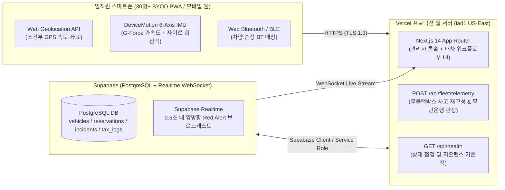

# FleetGuard 30 (Opelika, AL) — 실제 웹배포 계획 및 구현 보고서

> **대상 사업장:** `4400 Northpark Dr, Opelika, AL 36801` (Lee County, Alabama · `AL 41` 법인차량 30대)
> **핵심 전제:** 차량 내장 블랙박스(Dashcam) 0대 · 상업용 OBD/GPS 단말기 0대 · 월간 통신 구독료 **\$0**

---

## 1. 웹배포 아키텍처 개요 (Production Web Deployment Architecture)



---

## 2. 구현 완료된 프로덕션 배포 구성요소

| 구분 | 구현 파일 | 역할 및 설명 |
|---|---|---|
| **Vercel 배포 설정** | [`vercel.json`](file:///c:/dev/GPS/vercel.json) | 미국 동부(`iad1` — 앨라배마 Opelika 최단거리 리전) 지정, 보안 헤더(`X-Frame-Options`, `X-Content-Type-Options`) 및 스마트폰 센서 권한 헤더(`Permissions-Policy: geolocation, accelerometer, gyroscope, bluetooth`) 설정 |
| **모바일 PWA 매니페스트** | [`manifest.json`](file:///c:/dev/GPS/public/manifest.json), [`icon.svg`](file:///c:/dev/GPS/public/icon.svg) | 임직원이 별도 유료 앱스토어 배포 없이도 스마트폰 홈 화면에 즉시 설치(`Add to Home Screen`)하여 네이티브 앱처럼 사용할 수 있는 Standalone PWA 구성 |
| **실제 스마트폰 센서 브릿지** | [`realDeviceSensors.ts`](file:///c:/dev/GPS/src/utils/realDeviceSensors.ts) | 실제 스마트폰 브라우저의 GPS(`navigator.geolocation`), 6축 가속도·자이로(`DeviceMotionEvent`), 블루투스(`navigator.bluetooth`), 그리고 `4400 Northpark Dr, Opelika, AL` 기준 Haversine 거리 계산 함수 구현 |
| **백엔드 텔레메트리 API** | [`route.ts` (telemetry)](file:///c:/dev/GPS/src/app/api/fleet/telemetry/route.ts) | 스마트폰에서 올라오는 `[G-Force, Δv 속도변화, 자이로 회전각 °/s, 승인여부]` 패킷을 수신하여 **무블랙박스 실제 충돌 vs 휴대폰 단순 낙하(Sensor Fusion)** 및 **미승인 무단 출발(15km/h+)**을 서버 측에서 판정 |
| **헬스체크 API** | [`route.ts` (health)](file:///c:/dev/GPS/src/app/api/health/route.ts) | 배포 후 모니터링 및 지오펜스 설정 확인용 `/api/health` 엔드포인트 |
| **PostgreSQL / Supabase DB 스키마** | [`001_fleetguard30_schema.sql`](file:///c:/dev/GPS/supabase/migrations/001_fleetguard30_schema.sql) | 30대 차량 마스터(`vehicles`), 임직원 권한(`employees`), 4단계 배차(`vehicle_reservations`), 무블랙박스 사고 재구성(`incident_events`), 세무 운행일지(`tax_logs`) 테이블 및 `supabase_realtime` 퍼블리케이션 정의 |
| **환경변수 템플릿** | [`.env.example`](file:///c:/dev/GPS/.env.example) | Opelika 본사 좌표 및 Supabase 연동 키 템플릿 |

---

## 3. 단계별 실제 배포 절차 (Step-by-Step Rollout Plan)

### Phase 1 — 데이터베이스(Supabase) 프로비저닝 (소요 시간: 5분)
1. Supabase 프로젝트 생성 (Region: **US East - North Virginia `us-east-1`**, Free Tier로도 30대 법인차량 무제한 운영 가능, 월 비용 **\$0**).
2. Supabase SQL Editor에서 [`001_fleetguard30_schema.sql`](file:///c:/dev/GPS/supabase/migrations/001_fleetguard30_schema.sql) 실행 → 5개 핵심 테이블 및 실시간 WebSocket(`supabase_realtime`) 자동 활성화.

### Phase 2 — Vercel 프로덕션 웹 배포 (소요 시간: 3분)
> **주의:** `C:\dev\GPS`는 OneDrive 비동기화 영역(`C:\dev\`)에 위치하므로 글로벌 규칙에 따라 바로 안전하게 배포할 수 있습니다.

```powershell
# 1. Git 저장소 초기화 및 커밋
cd c:\dev\GPS
git init
git add .
git commit -m "feat: implement FleetGuard 30 Opelika AL fleet dispatch and no-dashcam telemetry system"

# 2. GitHub 원격 저장소 연결 후 푸시 또는 Vercel CLI 즉시 배포
npx vercel --prod
```

### Phase 3 — Opelika, AL 본사 현장 온보딩 (30대 차량 & 임직원 스마트폰)
1. **차량 30대 블루투스 MAC 등록 (1회, 30분):**
   - 관리자가 `솔루션 관리자 화면 (Admin Console) → 🚗 차량 30대 · 계기판 실사` 탭에서 각 차량(`AL 41A-2237` ~ `AL 41F-6210`)의 순정 핸즈프리 블루투스 MAC 주소와 현재 계기판 주행거리를 입력합니다.
2. **임직원 스마트폰 PWA 설치 (1분):**
   - 배포된 HTTPS URL(예: `https://fleetguard30-opelika.vercel.app`)을 사내 공지로 배포하고, 임직원 스마트폰(iOS Safari / Android Chrome)에서 **`홈 화면에 추가`** 및 위치·모션·블루투스 권한을 허용합니다.
3. **주간/월간 실사 대조 및 세무 리포트 출력:**
   - 매주 월요일 아침 주차장 순찰 시 실제 계기판 수치만 관리자 화면에 입력하면, 블루투스를 끄고 몰래 운행한 **유령 주행(Ghost Trip)** 여부가 즉시 자동 계산됩니다.
