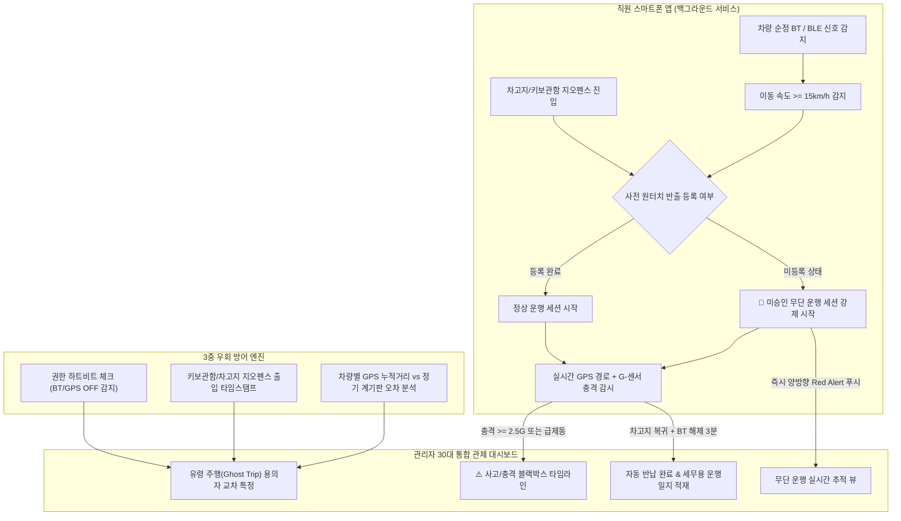

# FleetGuard 30 — 무구독 스마트폰 기반 법인차량(30대) 무단 운행·사고 추적 시스템 PRD & 명세서

> **작성 기준:** `/grill-me` 소크라테스식 인터뷰 8단계 합의안 + `spec-forge` 명세 프레임워크
> **본사 및 차고지 위치:** `4400 Northpark Dr, Opelika, AL 36801` (Lee County, Alabama, USA · 위경도 `32.6912, -85.3298`)
> **대상 규모:** 법인차량 30대 (앨라배마 Lee County `41` 프리픽스 번호판: `AL 41A-2237` ~ `AL 41F-6210`) · 임직원 스마트폰(BYOD) 및 관리자 웹/모바일 통합 관제
> **핵심 제약:** 상업용 OBD/GPS 단말기 및 **차량 내장 블랙박스(Dashcam) 0대** · 월간 통신 구독료 **\$0** (차량 순정 블루투스 및 스마트폰 6축 IMU 내장 센서만으로 운행·사고 100% 재구성)

---

## 1. 문제 프레이밍 (Problem Framing)

### 1.1 해결하려는 진짜 문제 (Root Cause)
- **증상:** 관리자가 자리를 비운 사이 직원이 보고 없이 자동차 키를 가지고 나가 운전하며, 사고나 차량 파손이 발생해도 누가 언제 운전했는지 추적할 수 없다.
- **근본 원인:**
  1. **물리적 키와 디지털 기록의 단절:** 자동차 키는 물리적으로 보관함에 걸려 있고, 수기 운행일지나 사전 결재는 번거롭기 때문에 관리자 부재 시 '선탑승·무보고'가 발생한다.
  2. **기존 솔루션의 비용 장벽:** 상업용 FMS(Fleet Management System)는 차량 30대 기준 단말기 설치비(\$3,000~5,000+)와 매월 대당 \$15~30의 통신 구독료(연간 \$5,400~10,800+)가 발생하여 도입이 어렵다.
  3. **무단 사용자의 자발적 기록 불가:** 보고 없이 몰래 키를 가져가는 사람은 스스로 앱을 열어 '운행 시작' 버튼을 누르지 않으므로, 수동 체크인 앱만으로는 무단 운행자를 절대 잡을 수 없다.

### 1.2 대상 사용자 및 현재의 고충
| 구분 | 현재 상황 및 고충 |
|---|---|
| **법인차량 관리자 (1~2명)** | 자리를 비울 때마다 키 반출 여부를 확인할 수 없고, 사후에 범퍼 파손·과속 고지서·사고가 발견되어도 운전자들이 모른 척하면 범인을 특정할 증거가 없음 |
| **일반 임직원 (운전자)** | 급한 외근 시 관리자가 없으면 허락받기 애매하고, 매번 계기판/외관 사진을 찍거나 수기 장부를 쓰는 절차가 번거로움. 또한 개인 휴대폰에 24시간 위치 추적 앱을 까는 것에는 강한 거부감이 있음 |

### 1.3 성공 측정 지표 (Success Metrics)
- **미승인 운행 즉시 포착률:** 사전 등록 없이 차량 시동 후 15km/h 이상 주행 시 **60초 이내 관리자 알림 도달률 98% 이상**
- **운행 기록 누락(유령 주행) 비율:** 월간 차량별 GPS 합산 주행거리와 실제 계기판 오차율 **3% 미만**, 미특정 유령 주행 **0건**
- **사고/충격 책임자 특정률:** 주행 중 급감속·충격(G-Sensor 임계치 초과) 발생 시 **운전자 및 위치 자동 특정률 100%**
- **하드웨어·통신 구독 비용:** **월 \$0** (차량 순정 블루투스 MAC 매칭 기본, 구형 차량에 한해 개당 \$3~5 일회성 USB BLE 비콘 선택 사용)

---

## 2. 범위 경계 (Scope Boundaries — MoSCoW)

| 등급 | 기능 항목 | 선정 이유 |
|---|---|---|
| **Must (출시 필수)** | **1) 백그라운드 자동 탑승·주행 감지 (Zero-Touch Start/Stop)** 차량 블루투스/BLE 신호 + GPS 이동 속도(15km/h 이상) 결합 감지로 버튼 조작 없이 주행 세션 자동 시작 및 차고지 복귀 시 자동 반납 | 무단 운전자 포착의 핵심 엔진 |
| **Must (출시 필수)** | **2) 원터치 자율 반출(선등록) & 미등록 출발 양방향 Red Alert** 관리자 부재 시에도 1초 원터치 자율 배차 지원, 미등록 상태로 출발 시 관리자·운전자 양쪽에 즉시 경고 푸시 발송 | 합법적 이용은 쉽게, 무단 반출은 즉시 차단 |
| **Must (출시 필수)** | **3) 3중 우회 방어 그물망 (Anti-Evasion)** 앱 위치·블루투스 권한 하트비트 감시 + 차고지/키보관함 지오펜스 출입 시각 로그 + 주행거리 공백(Ghost Trip) 용의자 역추적 | 직원이 고의로 블루투스/GPS를 끄는 행위 방어 |
| **Must (출시 필수)** | **4) 조건부 트리거 프라이버시 보호 (Zero-Tracking by Default)** 법인차량 블루투스/BLE 감지 시에만 실시간 GPS 활성화, 평상시 개인 자가용·퇴근 후 위치 수집 원천 차단 | 직원 사생활 보호 및 앱 설치 거부감 해소 |
| **Must (출시 필수)** | **5) 스마트폰 G-센서 기반 사고·급정거 자동 블랙박스 로깅** 충격(예: 2.5G 이상) 또는 급제동 감지 시 [시각·좌표·운전자·전후 속도 변화] 자동 박제 및 관리자 긴급 알림 | 무보고 사고 은폐 방지 및 책임자 특정 |
| **Must (출시 필수)** | **6) 3단계 다인 탑승 운전자 자동 판별 알고리즘** 배차/키보관함 동선 → 블루투스 핸즈프리 주 연결/RSSI 강도 → 미승인 시 탑승자 전원 연대 알림 및 원터치 동승 전환 | 여러 직원이 한 차에 탔을 때 실제 운전자 특정 |
| **Should (중요)** | **7) 관리자 30대 실시간 4분류 관제 보드 & 세무용 운행기록부 자동 생성** `대기` / `정상운행` / `무단운행` / `사고·권한주의` 4분류 현황판 및 국세청/감사 제출용 월별 엑셀(CSV) 자동 출력 | 관리자 일상 업무 자동화 |
| **Could (선택)** | **8) 외부 장기 정차 및 영업시간 외(심야/주말) 운행 별도 경보** 차고지 외부에서 30분 이상 미반납 방치 또는 심야 운행 시 별도 태그 부여 | 사적 유용 방지 강화 |
| **Won't (명시적 제외)** | **❌ 반출/반납 시 차량 외관 4면 및 계기판 사진 촬영 강제** **❌ 상업용 OBD-II 단말기 및 유료 LTE GPS 트래커 연동** **❌ 차량 원격 시동 차단(이모빌라이저 하드웨어 개조)** **❌ 업무 시간 상시(법인차량 미탑승 시) 직원 실시간 위치 추적** | 사진 촬영의 번거로움 제거, 하드웨어/구독료 \$0 원칙 준수, 직원 개인정보 침해 원천 배제 |

---

## 3. 시스템 아키텍처 및 핵심 작동 메커니즘

### 3.1 3단계 다인 탑승(동승자) 운전자 특정 로직
한 차량에 직원 $N$명이 함께 탑승하여 동일한 차량 블루투스/BLE 신호가 $N$대의 스마트폰에서 동시에 감지될 경우 다음 우선순위로 **주 운전자(책임자)**를 결정합니다:

1. **Step 1 (사전 반출자 & 키 보관함 동선 우선):** 해당 차량에 원터치 반출 등록을 한 직원, 또는 출발 직전 15분 이내에 **키 보관함 구역(또는 관리자석 BLE 비콘 반경 3m)에 가장 먼저 접근한 직원**을 운전자로 지정.
2. **Step 2 (차량 핸즈프리 Classic BT 연결 & RSSI 신호 강도):** 차량 순정 오디오(HFP/A2DP)에 직접 연결된 스마트폰을 우선 지정하며, 미연결 시 운전석 측 신호 강도(RSSI)가 가장 강한 단말기를 운전자로 추정.
3. **Step 3 (원터치 동승 확인 & 미승인 연대 책임):** 탑승자 전원에게 `[운전자 / 동승자 전환]` 알림을 발송하되, **사전 등록 없는 무단 운행이면서 전원이 '동승자'를 선택하거나 3분 내 무응답일 경우 탑승자 전원을 '무단 공동 탑승자'로 관리자에게 보고**.

### 3.2 3중 우회 방어 (Anti-Evasion) 및 유령 주행(Ghost Trip) 추적
직원이 고의로 스마트폰 블루투스나 위치 권한을 끄고 키를 가져가는 경우:
1. **권한 하트비트(Permission Heartbeat):** 운전 자격이 부여된 직원의 앱은 위치·블루투스 권한 활성 여부(좌표 제외, ON/OFF 상태값만)를 주기적으로 체크하며, 차고지 진입 직후 권한이 꺼지면 `'차고지 내 권한 비활성 이벤트'`를 기록합니다.
2. **유령 주행(Ghost Trip) 자동 탐지:**
   - **공간 불일치:** 직전 자동 반납 시 주차된 구역/좌표와 다음 운행 출발 시 차량이 감지된 구역이 다른 경우
   - **거리 불일치:** 관리자의 정기(주간/월간) 계기판 숫자 점검 시, 앱이 기록한 GPS 합산 주행거리보다 실제 계기판 주행거리가 비정상적으로 늘어난 경우
3. **용의자 자동 압축 리포트:** 유령 주행이 발생한 시간 구간 $[T_{\text{last\_return}}, T_{\text{next\_start}}]$ 동안 **(a) 차고지 지오펜스에 출입한 직원**, **(b) 해당 시간대에 블루투스/위치 권한이 꺼졌던 직원**을 교차 필터링하여 관리자 화면에 용의자 후보군을 즉시 제시합니다.

---

## 4. 핵심 사용자 흐름 (User Flows)

### 흐름 A — 관리자 부재 시 정상 자율 반출 및 자동 반납 (Zero-Touch Return)
1. **원터치 반출:** 직원이 `4400 Northpark Dr` 본관 키 보관함에서 키를 꺼내며 앱에서 `[AL 41A-2237 선택 → 업무 외근 → 출발]`을 터치 (입력 시간 3초 이내, 사진 촬영 없음).
2. **자동 주행 기록:** 차에 탑승해 시동을 걸면 앱이 차량 블루투스 MAC 주소를 확인하고 이동(15km/h 이상) 시 GPS 경로(`I-85 Corridor` / `Opelika` / `Auburn` / `HMMA Montgomery`) 및 G-센서 모니터링을 백그라운드로 수행.
3. **무조작 자동 반납:** 운행 후 `4400 Northpark Dr, Opelika, AL 36801` 차고지 지오펜스(반경 150m)로 진입하고 시동을 끄면(블루투스 신호 해제 후 3분 경과), 별도 버튼 조작 없이 **자동으로 반납 완료 처리**되고 주행거리·체류지·운행시간이 세무/감사용 운행기록부에 저장됨.

### 흐름 B — 보고 없이 키를 가지고 나간 무단 운행 실시간 포착
1. **무단 탑승 감지:** 직원이 앱에서 반출 등록을 하지 않고 키만 들고 나가 3호차(`AL 41A-9012`) 시동을 걸고 Northpark Dr 차고지를 이탈(속도 $\ge 15\text{km/h}$).
2. **양방향 즉시 경고 (Red Alert):**
   - **관리자 휴대폰/대시보드:** `"🚨 [미승인 운행] 박성훈 대리가 사전 등록 없이 3호차(AL 41A-9012)를 운행 중입니다."` 긴급 푸시 및 실시간 지도 활성화.
   - **운전자 휴대폰:** `"⚠️ 미승인 운행이 감지되어 관리자에게 자동 통보되었습니다. 즉시 운행 목적을 등록하세요."` 알림 표시 (사후 사유 입력 시에도 '선출발 후보고' 이력 태깅 유지).
3. **주행 및 체류지 전수 기록:** 무단 운행 세션의 모든 이동 경로, 정차 위치 및 체류 시간, 최고 속도, 급감속 이벤트가 관리자 대시보드에 실시간 스트리밍됨.

### 흐름 C — 주행 중 사고·충격 발생 시 자동 블랙박스 기록
1. **충격 감지:** 주행 중 스마트폰 가속도/자이로 합성 가속도가 임계치($\ge 2.5\text{G}$)를 초과하거나 급감속($\Delta v \ge 30\text{km/h per 2s}$) 직후 비정상 정차가 발생.
2. **사고 패킷 즉시 전송:** 운전자가 아무 조치를 하지 않아도 앱이 즉시 `[발생 시각, 정확한 GPS 좌표/주소(예: US-280 & Gateway Dr, Opelika, AL), 탑승 차량 번호(AL 41B-4821), 운전자/동승자 명단, 충격 전후 30초 속도 그래프]`를 서버에 영구 기록.
3. **관리자 긴급 알림:** 관리자에게 `"💥 [사고/충격 의심] 7호차(AL 41B-4821 · 운전자: 김민수 과장)에서 강한 충격(3.18G)이 감지되었습니다"` 알림 발송 및 즉시 통화 연결 버튼 제공.

---

## 5. 수용 기준 (Acceptance Criteria — Given / When / Then)

### AC-1: 미승인 무단 운행 자동 포착
- **Given:** 특정 법인차량(예: `AL 41A-9012`)에 대해 현재 시간대에 유효한 반출 등록이 없는 상태에서,
- **When:** 직원의 스마트폰에서 `AL 41A-9012`의 등록된 블루투스/BLE 식별자가 감지되고 GPS 이동 속도가 10초 이상 연속으로 `15km/h` 이상을 기록하면,
- **Then:** 시스템은 `60초` 이내에 해당 세션을 `UNAUTHORIZED_ACTIVE`(미승인 운행)로 생성하고, 관리자와 해당 직원 양쪽에 푸시 알림을 발송하며 실시간 경로 기록을 시작한다.

### AC-2: 조건부 프라이버시 보장 (개인 시간 위치 미수집)
- **Given:** 직원이 퇴근 후 또는 업무 시간 중 본인의 개인 자가용을 이용해 `15km/h` 이상으로 이동하는 상태에서,
- **When:** 주변에 등록된 법인차량 30대(`AL 41` 플릿)의 블루투스/BLE 식별자가 감지되지 않고 `4400 Northpark Dr, Opelika, AL 36801` 차고지 지오펜스 외부에 있다면,
- **Then:** 앱은 서버로 어떠한 GPS 좌표도 전송하거나 저장하지 않는다 (데이터 전송 패킷 0건 보장).

### AC-3: 주행 중 사고/충격 자동 로깅
- **Given:** 법인차량 운행 세션(`AUTHORIZED_ACTIVE` 또는 `UNAUTHORIZED_ACTIVE`)이 진행 중인 상태에서,
- **When:** 스마트폰 센서에서 `2.5G` 이상의 충격 가속도 또는 2초 내 `30km/h` 이상의 급감속 후 정차가 감지되면,
- **Then:** 운전자의 수동 조작 없이 `5초` 이내에 서버에 `INCIDENT_SHOCK` 이벤트(시각, 위경도, 차량 ID, 운전자 ID, 충격량 G, 전후 30초 속도 배열)가 저장되고 관리자에게 긴급 알림이 표시된다.

### AC-4: 다인 탑승 시 운전자 자동 특정 및 연대 알림
- **Given:** 사전 반출 등록이 없는 `AL 41A-9012` 차량에서 직원 A와 직원 B의 스마트폰이 동시에 감지되어 이동을 시작한 상태에서,
- **When:** 출발 10분 전 `4400 Northpark Dr` 키 보관함 지오펜스에 직원 A만 접근했거나 직원 A의 휴대폰이 차량 핸즈프리에 연결되어 있다면,
- **Then:** 시스템은 직원 A를 `주 운전자(Primary Driver)`, 직원 B를 `동승자(Passenger)`로 자동 분류하며, 만약 두 사람 모두 조건이 동일하고 3분간 운전자 확인 응답이 없으면 A와 B 전원을 `미승인 공동 탑승자`로 관리자 관제 보드에 표시한다.

### AC-5: 차고지 복귀 시 무조작 자동 반납
- **Given:** 운행 중인 차량이 `4400 Northpark Dr, Opelika, AL 36801` 차고지 지오펜스(반경 `150m`) 내부로 진입한 상태에서,
- **When:** 차량 블루투스/BLE 신호가 끊기거나 이동 속도가 `0km/h`로 `3분` 이상 유지되면,
- **Then:** 운전자가 반납 버튼을 누르지 않아도 세션 상태가 `COMPLETED`로 자동 전환되고, 총 주행거리(GPS 적산)와 최종 주차 좌표(`Northpark Lot A/B/C`)가 세무/감사용 운행기록부 테이블에 자동 반영된다.

---

## 6. 데이터 모델 및 추천 기술 스택

### 6.1 핵심 엔티티 (PostgreSQL / Supabase 기준)
- **`vehicles` (법인차량 30대 마스터):** `id`, `plate_number` (차량번호), `model_name`, `bt_mac_address` (순정 블루투스 MAC / BLE UUID), `status` (`IDLE` | `AUTHORIZED` | `UNAUTHORIZED` | `INCIDENT`), `cumulative_gps_km`, `last_verified_odometer_km`, `last_parking_lat`, `last_parking_lng`
- **`employees` (임직원 및 권한 상태):** `id`, `name`, `department`, `phone`, `app_permission_status` (`OK` | `BT_OFF` | `GPS_OFF` | `STALE`), `last_heartbeat_at`
- **`geofence_logs` (차고지/키보관함 출입 로그):** `id`, `employee_id`, `zone_type` (`GARAGE` | `KEYBOX`), `entered_at`, `exited_at`, `permission_state_at_entry`
- **`trips` (운행 세션 & 세무용 운행기록부):** `id`, `vehicle_id`, `primary_driver_id`, `co_passenger_ids[]`, `auth_type` (`PRE_REGISTERED` | `LATE_REGISTERED` | `UNAUTHORIZED`), `purpose` (`출퇴근` | `일반업무/외근` | `거래처방문` | `미입력`), `started_at`, `ended_at`, `distance_km`, `route_polyline`, `max_speed_kmh`
- **`incident_events` (사고·충격·규정위반 블랙박스):** `id`, `trip_id`, `vehicle_id`, `driver_id`, `event_type` (`IMPACT_SHOCK` | `HARD_BRAKE` | `UNAUTHORIZED_START` | `GHOST_TRIP_SUSPECT`), `g_force`, `speed_trace_json`, `lat`, `lng`, `occurred_at`, `resolved_by_manager`

### 6.2 추천 기술 스택
| 영역 | 기술 스택 | 선정 이유 |
|---|---|---|
| **관리자 관제 웹 & 모바일 통합 대시보드** | Next.js 14+ (App Router), TypeScript, Tailwind CSS, Lucide React | 30대 현황판, 실시간 지도 관제, 세무용 엑셀 내보내기를 단일 코드베이스로 즉시 배포 가능 |
| **직원용 모바일 앱 (백그라운드 센서)** | React Native (Expo Managed + Background Location / BLE / Accelerometer) | iOS/Android 백그라운드 블루투스 스캔, 지오펜싱, G-센서 충격 감지를 단일 TypeScript 코드로 구현 |
| **실시간 백엔드 & DB** | Supabase (PostgreSQL + Realtime + Auth) | 무단 운행 및 사고 발생 시 WebSocket(Supabase Realtime)으로 관리자 화면에 0.5초 내 즉시 알림 반영 (무료/저비용 티어로 30대 충분히 운영 가능) |

---

## 7. 가장 틀리기 쉬운 가정 3가지와 검증 방법 (Risks & Fragile Assumptions)

| # | 취약한 가정 (Fragile Assumption) | 실패 시나리오 | 사전 검증 및 보완책 (Mitigation) |
|---|---|---|---|
| **1** | **"모든 법인차량(30대)의 순정 블루투스는 스마트폰이 페어링 없이도 백그라운드에서 식별할 수 있을 것이다."** | 일부 차량의 순정 블루투스는 최초 1회 페어링된 휴대폰과만 자동 연결되거나, iOS 백그라운드 제약으로 Classic Bluetooth MAC 스캔이 제한될 수 있음 | **보완책:** 시동을 걸면 전원이 켜지는 **차량 시거잭 USB 포트용 초저가 BLE 비콘(개당 \$3~4, 배터리 교체 및 월 구독료 0원, iBeacon/Eddystone 표준 UUID 송출)**을 구형/미지원 차량에 꽂아두면 iOS/Android 모두 페어링 없이 100% 백그라운드 자동 감지 가능 |
| **2** | **"스마트폰 G-센서만으로 실제 차량 접촉사고와 단순 휴대폰 낙하(바닥에 떨어뜨림)를 구분할 수 있을 것이다."** | 운전 중 휴대폰이 거치대에서 바닥으로 떨어질 때 발생하는 충격(3~5G)을 차량 충돌 사고로 오탐(False Alarm)할 위험 | **보완책:** **복합 조건 필터(Sensor Fusion)** 적용 — 단순 가속도 피크($\ge 2.5\text{G}$)만 보지 않고, 충격 직후 **GPS 속도의 급격한 감소($\Delta v$)** 또는 **충격 후 30초 이상 정차 지속 여부**를 함께 결합해 휴대폰 단순 낙하(속도 변화 없음)를 자동 필터링 |
| **3** | **"직원들이 개인 스마트폰에 법인차량 관리 앱을 설치하고 위치·블루투스 '항상 허용' 권한을 유지하는 데 동의할 것이다."** | 사생활 감시 우려로 권한을 '앱 사용 중에만 허용'으로 바꾸거나 백그라운드 실행을 강제 종료할 가능성 | **보완책:** 앱 첫 화면에 **'현재 위치 미수집 중 (법인차량 블루투스 미감지)'** 배지를 투명하게 실시간 표시하여 안심시키고, **법인차량 운전 자격 정책상 앱 권한이 활성 상태일 때만 키 반출을 허용**하도록 사내 규정과 연동 |

---

## 8. 검증 체크리스트 (spec-forge Gate)
- [x] `Won't` 목록이 비어있지 않다 (사진 촬영 강제, 유료 OBD/GPS 구독, 원격 시동 차단, 상시 개인 위치 추적 명시적 제외)
- [x] 모든 `Must` 항목에 Given-When-Then 수용 기준(AC-1 ~ AC-5)이 정의되어 있다
- [x] 성공 지표가 수치로 측정 가능하다 (60초 이내 알림 도달률 98%, 오차율 3% 미만, 구독료 \$0)
